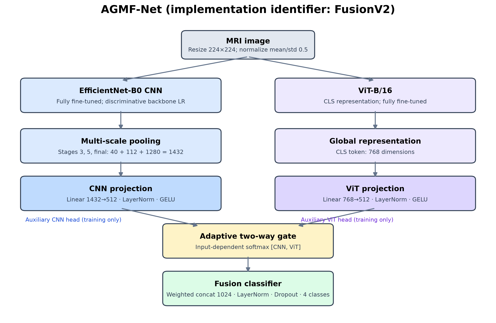
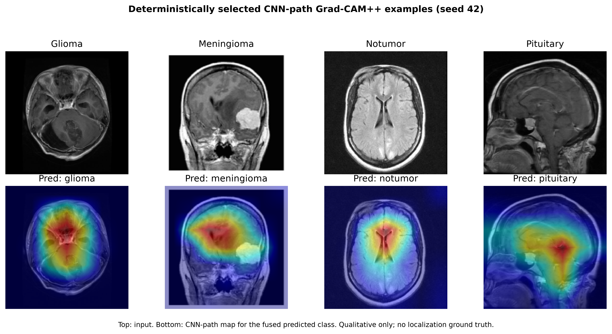
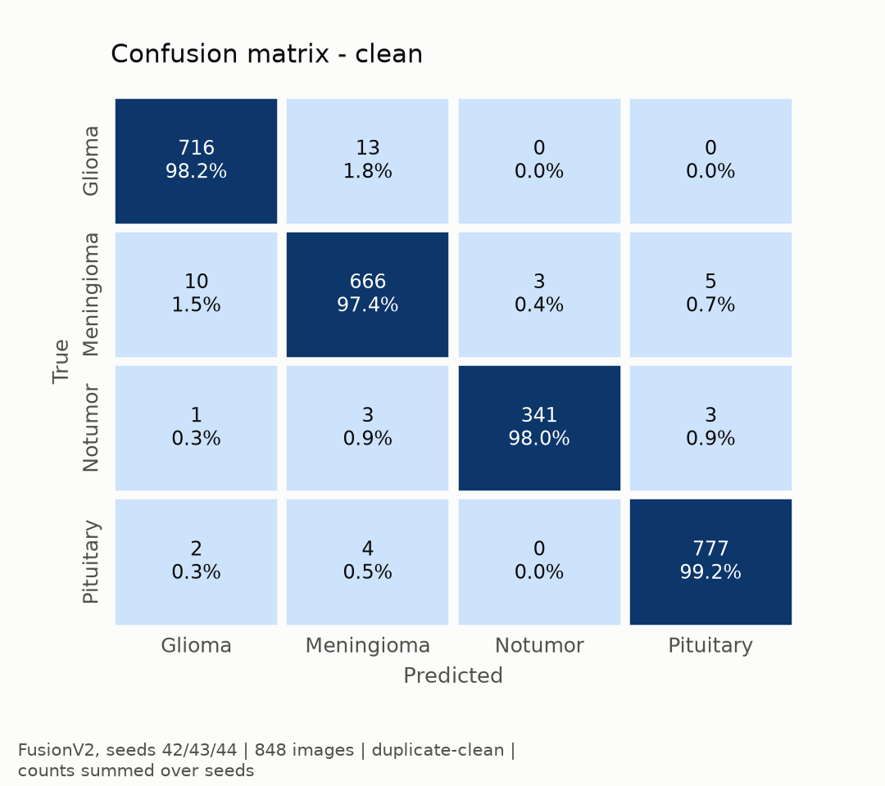
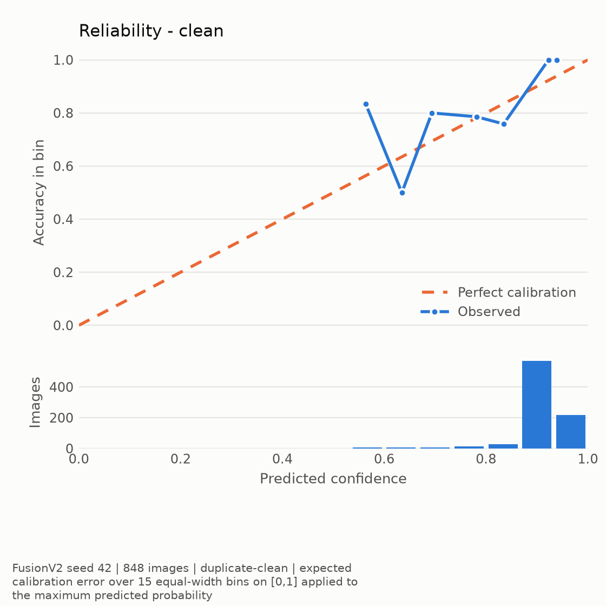
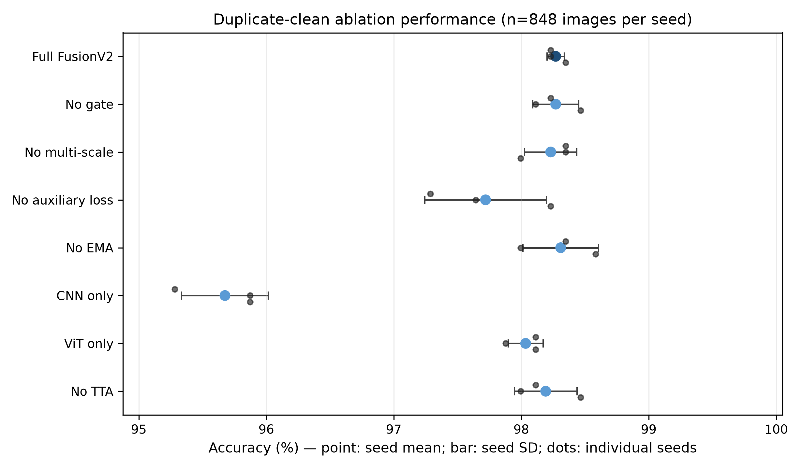
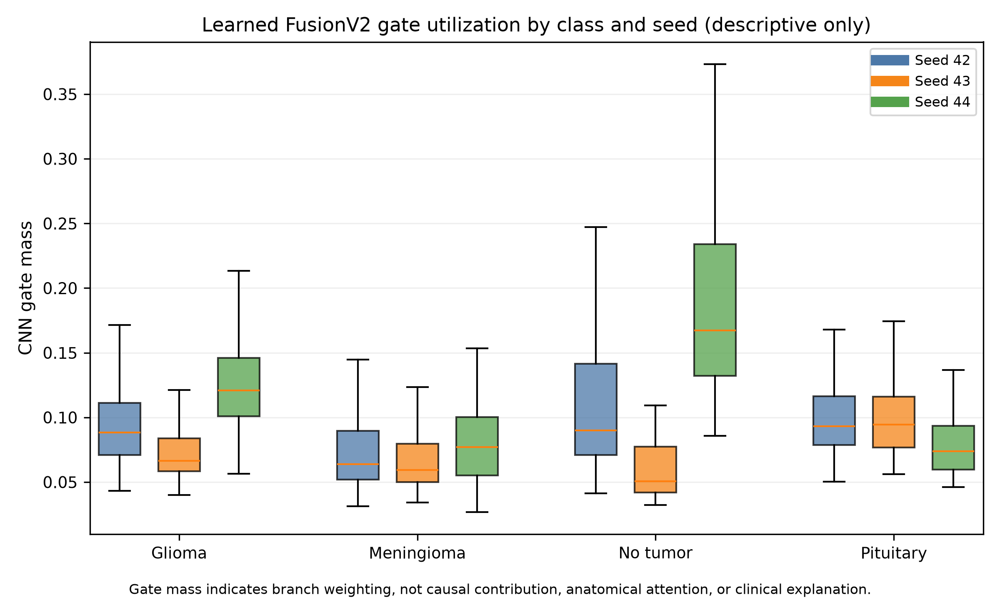
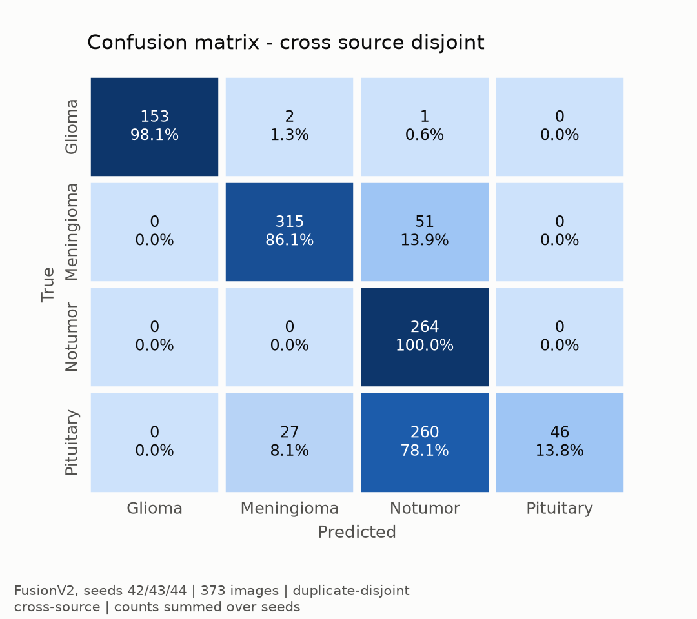

# AGMF-Net: Adaptive Gated Multi-scale CNN–Vision Transformer Fusion for Duplicate-Aware Brain MRI Classification

**Authors:** [AUTHOR 1], [AUTHOR 2], [AUTHOR 3]

**Affiliations:** [AFFILIATION 1]; [AFFILIATION 2]

**Corresponding author:** [NAME, POSTAL ADDRESS, EMAIL]

> **Editable submission draft.** Replace every bracketed placeholder and adapt length, reference style, and declarations to the selected journal before submission. AGMF-Net is the publication-facing name of the repository implementation `FusionV2`; no model was renamed or retrained to prepare this manuscript.

## Highlights

- AGMF-Net combines multi-depth EfficientNet-B0 features with a ViT-B/16 representation through an input-dependent two-way gate.
- Three-seed accuracy was 99.14 ± 0.10% on the conventional image split and 98.27 ± 0.07% after duplicate-aware repartitioning.
- Accuracy fell to 69.53 ± 1.98% on a 373-image duplicate-disjoint cross-source subset, exposing a marked distribution-shift limitation.
- Controlled ablations supported the contribution of the ViT branch; evidence for several additional components was small or inconclusive.
- CNN-path Grad-CAM++ is provided as a qualitative visualization and is not presented as validated tumor localization.

## Abstract

### Background

High reported accuracy on public brain magnetic resonance imaging (MRI) benchmarks can conceal near-duplicate images, unverified patient overlap, and source-specific cues. Hybrid convolutional neural network (CNN)–Vision Transformer (ViT) models may combine local and global representations, but their additional components require controlled evaluation.

### Method

We developed AGMF-Net, an adaptive gated multi-scale fusion network for four-class classification of 2D brain MRI images as glioma, meningioma, no-tumor, or pituitary. The model combines pooled features from three EfficientNet-B0 depths with the class-token representation of ViT-B/16. Both branches are projected to 512 dimensions, weighted by an input-dependent two-way softmax gate, concatenated, and classified. Auxiliary branch objectives, exponential moving-average weights, and horizontal-flip test-time augmentation were evaluated through one-component-at-a-time ablations. Experiments used seeds 42–44. We report conventional, duplicate-clean, and duplicate-disjoint cross-source evaluations, together with image-level bootstrap intervals, calibration measures, paired McNemar tests, and Holm correction across 21 seed-specific comparisons.

### Results

AGMF-Net achieved 99.14 ± 0.10% accuracy and 99.12 ± 0.09% macro-F1 on the conventional split (1,052 images), and 98.27 ± 0.07% accuracy and 98.28 ± 0.04% macro-F1 on the duplicate-clean split (848 images). On 373 duplicate-disjoint cross-source images, accuracy decreased to 69.53 ± 1.98% and macro-F1 to 68.69 ± 2.21%. Removing the ViT branch reduced accuracy by 2.59 percentage points and was significant for all three seeds after Holm correction. Removing auxiliary losses reduced mean accuracy by 0.55 percentage points, but no seed-specific test remained significant after multiplicity correction. No detectable accuracy benefit was observed for the learned gate, multi-scale taps, exponential moving average, or test-time augmentation under this protocol. The published BRAIN-META accuracy of 97.10% is included only as a contextual reported value because its split, preprocessing, and ten-model stacking pipeline differ.

### Conclusion

AGMF-Net provides a reproducible single-model CNN–ViT fusion pipeline with strong image-level internal performance. Duplicate-aware and cross-source analyses substantially qualify that result: patient independence could not be verified, and external-source degradation was pronounced. The system is a research benchmark and is not validated for clinical diagnosis.

**Keywords:** brain tumor classification; magnetic resonance imaging; EfficientNet; Vision Transformer; adaptive gating; duplicate-aware evaluation; calibration; Grad-CAM++

## Specifications table

| Item | Description |
|---|---|
| Subject area | Computer science; medical image analysis |
| Method name | AGMF-Net: Adaptive Gated Multi-scale Fusion Network |
| Repository implementation | `FusionV2` |
| Task | Four-class 2D brain MRI image classification |
| Classes | glioma, meningioma, no-tumor, pituitary |
| Primary evaluation | Duplicate-clean held-out image split, seeds 42–44 |
| Contextual base paper | BRAIN-META, MethodsX 16 (2026) 103769 |
| Resource availability | Code and immutable evidence package: [INSERT REPOSITORY/ARCHIVE DOI] |

## 1. Introduction

Brain tumors exhibit substantial variation in morphology, location, intensity, and surrounding anatomy. MRI provides high soft-tissue contrast without ionizing radiation, but interpretation remains dependent on acquisition context and specialist judgment. Image classifiers may support research into automated characterization; nevertheless, high benchmark performance alone does not establish clinical utility.

CNNs encode local texture and shape through spatially shared filters, whereas ViTs model longer-range interactions through self-attention [4,5]. Their complementary inductive biases motivate hybrid architectures [6]. The BRAIN-META method combined ten CNN–ViT learners with logistic-regression and XGBoost meta-learners and reported 97.10% accuracy and 96.94% F1 on a four-class MRI benchmark [1]. That design demonstrates the potential of local–global ensembles but also requires training and aggregating multiple large base models. Reported values from different partitions cannot be interpreted as controlled model comparisons.

Public image collections create additional evaluation risks. Visually similar exports may occur on both sides of an image-wise split, while patient identifiers are often absent. Medical-imaging guidance therefore emphasizes group-aware partitioning, external assessment, calibration, and explicit reporting of the evaluation unit [15,16]. Distribution shifts can produce large external-performance losses despite strong internal results [17].

This study addresses these issues with AGMF-Net, a single CNN–ViT model that uses multi-depth CNN features, dimension-matched branch projections, adaptive fusion, and auxiliary branch supervision. Its principal contribution is not a claim that every architectural addition improves accuracy. Instead, the study couples the model with duplicate-aware partitioning, three-seed ablations, paired statistical tests, calibration measures, and a duplicate-disjoint cross-source stress test. The contributions are:

1. a reproducible multi-scale EfficientNet-B0 and ViT-B/16 fusion architecture with an input-dependent two-way gate;
2. conventional and duplicate-clean three-seed evaluation with prediction-level provenance;
3. controlled ablations of gating, multi-scale features, auxiliary loss, exponential moving average (EMA), test-time augmentation (TTA), and both branches;
4. calibration and cross-source analyses that expose limitations hidden by a headline internal accuracy; and
5. CNN-path Grad-CAM++ visualizations accompanied by explicit faithfulness and localization limits.

## 2. Related work

EfficientNet scales depth, width, and resolution jointly and provides an efficient convolutional backbone [4]. ViT-B/16 represents an image as 16×16 patches and uses a class token for classification [5]. Conformer is an important precedent for coupling local convolutional and global transformer representations, although AGMF-Net does not implement Conformer blocks [6]. Deep supervision motivates the auxiliary objectives attached to both projected branches [7].

BRAIN-META is the principal contextual comparator [1]. It uses ten CNN–ViT base learners, contrast enhancement, and stacked meta-learning. AGMF-Net instead uses one EfficientNet–ViT pair and feature-level adaptive fusion. Because the pipelines and evaluation splits differ and BRAIN-META per-image predictions are unavailable, no paired test or statistical-superiority claim is made.

Calibration is relevant because neural-network probabilities can be poorly aligned with observed correctness [18]. We therefore report negative log-likelihood (NLL), multiclass Brier score, expected calibration error (ECE), and reliability diagrams. Grad-CAM and Grad-CAM++ offer class-conditioned visualizations from convolutional feature maps [14,23], but such maps are not equivalent to causal explanations or validated tumor masks.

## 3. Materials and methods

### 3.1 Dataset and labels

The aggregate Brain Tumor MRI Dataset contains 7,023 JPEG images in four folders: glioma, meningioma, no-tumor, and pituitary [2]. The local export provides image labels but no defensible patient, study, series, scanner, institution, or acquisition identifier. A metadata audit found no DICOM headers, EXIF identifiers, or documented filename convention capable of supporting patient grouping. Consequently, all reported units are images, and patient-level independence remains unverified.

### 3.2 Duplicate-aware partition

Exact and perceptual similarity screening grouped the 7,023 pooled images into 5,648 clusters using the recorded project procedure and a Hamming-distance threshold of eight. One representative per cluster was retained, removing 1,375 redundant images. A seeded class-stratified partition produced 4,800 training images and 848 testing images. The clean test distribution was 243 glioma, 228 meningioma, 116 no-tumor, and 261 pituitary images. Perceptual similarity is an image-level safeguard; it cannot establish subject independence.

### 3.3 Preprocessing and augmentation

Evaluation images were resized to 224×224, converted to RGB tensors, and normalized channel-wise using mean 0.5 and standard deviation 0.5. Training used random resized crops with scale 0.8–1.0, horizontal flipping, rotations up to 15 degrees, and brightness/contrast jitter of 0.2. The horizontal-flip assumption is task-specific and was evaluated through a no-TTA control.

### 3.4 AGMF-Net architecture

**Figure 1.** AGMF-Net architecture. The model is implemented as `FusionV2` in the accompanying repository.

EfficientNet-B0 supplies pooled outputs from stages 3 and 5 and the final convolutional stage, with 40, 112, and 1,280 channels, respectively. Their concatenation gives a 1,432-dimensional CNN vector. ViT-B/16 supplies a 768-dimensional class-token vector. Separate Linear–LayerNorm–GELU projections map both vectors to 512 dimensions.

Let projected CNN and ViT features be $c,v\in\mathbb{R}^{512}$. The gate is

$$g=\operatorname{softmax}(W_2\,\operatorname{GELU}(W_1[c;v])),$$

where $g=[g_c,g_v]$ and $g_c+g_v=1$. The fused representation is

$$z=[2g_c c;\,2g_v v].$$

The factor two maintains a feature scale comparable to unweighted concatenation when the gate is balanced. A LayerNorm–Dropout–Linear head maps the 1,024-dimensional fused vector to four logits. Auxiliary linear classifiers operate on $c$ and $v$ during training. Gate mass is reported as branch utilization, not causal importance.

### 3.5 Optimization and inference

Both pretrained backbones were fine-tuned, with backbone learning rates set to 0.1 times the learning rate of newly initialized modules. Training used AdamW [8], learning rate $10^{-4}$, weight decay 0.05, batch size 16, label smoothing 0.1 [9], cosine annealing [10], a maximum of 15 epochs, and early stopping after four validation epochs without improvement. Auxiliary loss weight was 0.3. EMA weights were maintained during training [12]. Inference averaged softmax outputs from the original and horizontally flipped images [13]. Model selection used validation performance; external labels were not used for selection.

### 3.6 Evaluation and statistical analysis

Metrics included accuracy, macro precision, macro recall, macro-F1, balanced accuracy, one-versus-rest ROC-AUC, average precision, NLL, multiclass Brier score, 15-bin ECE, and confusion matrices. Macro-F1 is the arithmetic mean of four per-class F1 values. ECE used 15 equal-width bins of maximum predicted probability. Stratified bootstrap intervals used 2,000 image-level resamples with fixed seed 12,345 [20]. These intervals quantify image-sample uncertainty within a seed, not patient-level or training-seed uncertainty.

Ablations used identical clean partitions and seeds 42–44. Each variant changed one component. Exact paired McNemar tests compared each seed-specific ablation with the corresponding full model on the same 848 filenames [19]. Holm correction was applied jointly to 21 comparisons. The three seed runs were never pooled as 2,544 independent observations.

### 3.7 CNN-path Grad-CAM++

Grad-CAM++ backpropagated the selected fused class logit to the last spatial EfficientNet stage [23]. The resulting 7×7 response was upsampled for display. When TTA is enabled, the displayed probability averages original and flipped views, whereas the current map explains the original-view forward pass for the selected class. The visualization therefore does not exactly decompose the TTA average or spatially explain the ViT branch.

**Figure 6.** First filename-ordered clean-test example from each class, selected before viewing the maps. The overlays are qualitative CNN-path visualizations; no mask, bounding box, or clinician annotation was available.

## 4. Results

### 4.1 Overall discrimination and calibration

| Evaluation | Images | Accuracy, % | Macro-F1, % | ECE | Interpretation |
|---|---:|---:|---:|---:|---|
| Conventional/original | 1,052 | 99.14 ± 0.10 | 99.12 ± 0.09 | 0.0756 | Secondary internal result |
| Duplicate-clean | 848 | 98.27 ± 0.07 | 98.28 ± 0.04 | 0.0752 | Primary internal result |
| Duplicate-disjoint cross-source | 373 | 69.53 ± 1.98 | 68.69 ± 2.21 | 0.1618 | Distribution-shift stress test |
| BRAIN-META, paper reported [1] | 1,311 | 97.10 | 96.94 | Not reported | Context only; different protocol |

Values for AGMF-Net are mean ± sample standard deviation across seeds 42–44. BRAIN-META used a reported 80/20 split, CLAHE, ten CNN–ViT learners, and XGBoost stacking; therefore, the numerical difference is not a controlled head-to-head effect.

**Figure 3.** Duplicate-clean confusion matrices for three independently trained seeds.

**Figure 4.** Reliability analysis on the duplicate-clean split. Sparse low-confidence bins limit interpretation.

### 4.2 Ablation study

**Figure 2.** Three-seed accuracy for the full model and controlled ablations.

| Variant | Accuracy, % | Change, pp | Holm-significant seeds | Evidence-controlled conclusion |
|---|---:|---:|---:|---|
| Full AGMF-Net | 98.27 ± 0.07 | 0.000 | Reference | Reference |
| No learned gate | 98.27 ± 0.18 | 0.000 | 0/3 | No detectable accuracy benefit under this protocol |
| No multi-scale taps | 98.23 ± 0.20 | −0.039 | 0/3 | No detectable accuracy benefit under this protocol |
| No auxiliary loss | 97.72 ± 0.48 | −0.550 | 0/3 | Suggestive but inconclusive |
| No EMA | 98.31 ± 0.30 | +0.039 | 0/3 | No detectable accuracy benefit under this protocol |
| CNN branch only | 95.68 ± 0.34 | −2.594 | 3/3 | ViT contribution supported by consistent accuracy evidence |
| ViT branch only | 98.03 ± 0.14 | −0.236 | 0/3 | CNN contribution suggestive but inconclusive |
| No TTA | 98.19 ± 0.25 | −0.079 | 0/3 | No detectable accuracy benefit under this protocol |

The results reject a simple narrative that every added mechanism improved accuracy. The ViT branch made the clearest contribution. The auxiliary-loss effect was directionally larger than other component effects but did not survive the prespecified family-wise correction.

### 4.3 Gate behavior

**Figure 5.** Learned gate utilization by class and seed. Gate values vary by input but are descriptive and do not establish that either branch causally improves a prediction.

### 4.4 Cross-source degradation

**Figure 7.** Confusion matrices for the 373 duplicate-disjoint cross-source images.

The degradation was class-specific. Across the three seeds, the same 111 pituitary images produced 333 repeated predictions; 260 of these predictions (78.1%) were no-tumor. These are repeated model outputs, not 333 independent clinical cases. No-tumor recall was 100%, while mean pituitary recall was 13.81%. This asymmetry is consistent with source shift but does not identify its cause because scanner and acquisition metadata are unavailable.

## 5. Discussion

AGMF-Net achieved high internal image-level performance after duplicate-aware repartitioning. The 0.87-percentage-point difference between conventional and clean accuracy illustrates why duplicate screening belongs in benchmark reporting. More importantly, cross-source accuracy declined by almost 29 percentage points relative to the clean internal estimate, with a concentrated pituitary-to-no-tumor failure mode. The external result therefore changes the interpretation from “near-perfect classifier” to “high-performing internal benchmark model with unresolved distribution sensitivity.”

The ablation evidence also narrows the architectural claim. Removing the ViT branch caused a consistent and corrected-significant loss, supporting global transformer information under the tested protocol. The CNN-only and ViT-only comparisons do not establish symmetric complementarity: removing the CNN branch yielded a smaller, non-significant mean loss. Similarly, gate variation proves input-dependent utilization but not incremental accuracy. AGMF-Net should therefore be presented as the evaluated full design, while the empirical contribution of its components is reported without embellishment.

Compared with BRAIN-META, AGMF-Net replaces ten base learners and a meta-learner with one feature-level hybrid. This is an architectural distinction, not a controlled efficiency or superiority result. Hardware-matched runtime and identical-split reproduction would be required for such claims.

The Grad-CAM++ implementation improves demonstrability but does not solve explainability validation. The final convolutional grid is coarse, the ViT pathway lacks a corresponding spatial decomposition, and no localization ground truth was available. Future work should use prospectively defined lesion masks, deletion/insertion tests, transformation stability, and clinician-blinded assessment.

## 6. Limitations

First, patient identifiers were unavailable; duplicate-clean means image-similarity-aware, not patient-independent. Second, only three training seeds were available, and seed standard deviations are not confidence intervals. Third, the cross-source subset originates from one additional collection and is not multicenter clinical validation. Fourth, BRAIN-META is a contextual comparator because protocols and predictions differ. Fifth, multiple ablation testing limits power for small effects; non-significance is not equivalence. Sixth, calibration analysis is descriptive and does not establish clinically reliable probabilities. Seventh, qualitative Grad-CAM++ maps lack localization ground truth. Finally, retrospective public JPEG benchmarks omit sequence, scanner, demographic, and clinical context needed for clinical deployment.

## 7. Conclusion

AGMF-Net is a reproducible adaptive gated EfficientNet–ViT classifier with strong conventional and duplicate-clean image-level performance. Controlled analysis supports the contribution of the ViT branch but does not show that every fusion component improves accuracy. Cross-source degradation and unverified patient independence are central findings, not peripheral caveats. The present evidence supports publication as a transparent benchmark and methods study; it does not support clinical-readiness claims.

## Ethics statement

This study used a publicly distributed, retrospectively assembled image benchmark and did not recruit participants or access direct identifiers. **[AUTHORS: confirm the source dataset terms and insert the applicable institutional ethics/IRB determination; do not submit this placeholder.]**

## CRediT authorship contribution statement

**[AUTHOR 1]:** Conceptualization, Methodology, Software, Validation, Writing—original draft. **[AUTHOR 2]:** Supervision, Formal analysis, Writing—review and editing. **[AUTHOR 3]:** Data curation, Visualization, Writing—review and editing. **[AUTHORS: revise to match actual contributions.]**

## Funding

**[INSERT VERIFIED FUNDING STATEMENT OR “This research received no external funding.”]**

## Declaration of competing interest

**[AUTHORS: insert the journal-compliant competing-interest declaration.]**

## Declaration of generative AI and AI-assisted technologies

Generative AI tools were used to assist manuscript drafting and document formatting. The authors are responsible for verifying every claim, citation, numerical result, and interpretation and must revise this declaration to comply with the target journal’s policy.

## Data and code availability

The aggregate Brain Tumor MRI Dataset is available from its cited public record [2], subject to the host’s terms. Prediction files, split manifests, analysis scripts, checkpoint hashes, and reproducibility evidence should be deposited at **[INSERT REPOSITORY AND PERMANENT ARCHIVE DOI]**. Patient identifiers and acquisition metadata were not available in the local dataset export.

## References

1. Napa KK, Murugan S, Murugan JS, Jayanthi A. BRAIN-META: A reproducible CNN–vision transformer meta-ensemble pipeline for explainable brain tumor classification. *MethodsX*. 2026;16:103769. doi:10.1016/j.mex.2025.103769.
2. Nickparvar M. Brain Tumor MRI Dataset. Kaggle; 2021. https://www.kaggle.com/dsv/2645886.
3. Cheng J, et al. Enhanced performance of brain tumor classification via tumor region augmentation and partition. *PLoS One*. 2015;10:e0140381. doi:10.1371/journal.pone.0140381.
4. Tan M, Le QV. EfficientNet: Rethinking model scaling for convolutional neural networks. *Proc ICML*. 2019;97:6105–6114.
5. Dosovitskiy A, et al. An image is worth 16×16 words: Transformers for image recognition at scale. *ICLR*. 2021.
6. Peng Z, et al. Conformer: Local features coupling global representations for visual recognition. *ICCV*. 2021:367–376. doi:10.1109/ICCV48922.2021.00042.
7. Lee CY, Xie S, Gallagher P, Zhang Z, Tu Z. Deeply-supervised nets. *AISTATS*. 2015;38:562–570.
8. Loshchilov I, Hutter F. Decoupled weight decay regularization. *ICLR*. 2019.
9. Szegedy C, et al. Rethinking the Inception architecture for computer vision. *CVPR*. 2016:2818–2826.
10. Loshchilov I, Hutter F. SGDR: Stochastic gradient descent with warm restarts. *ICLR*. 2017.
11. Yosinski J, Clune J, Bengio Y, Lipson H. How transferable are features in deep neural networks? *NeurIPS*. 2014;27.
12. Tarvainen A, Valpola H. Mean teachers are better role models. *NeurIPS*. 2017;30.
13. Shanmugam D, Blalock D, Balakrishnan G, Guttag J. Better aggregation in test-time augmentation. arXiv:2011.11156. 2020.
14. Selvaraju RR, et al. Grad-CAM: Visual explanations from deep networks via gradient-based localization. *ICCV*. 2017:618–626.
15. Tampu IE, et al. Inflation of test accuracy due to data leakage in deep learning-based classification of OCT images. *Sci Data*. 2022;9:580.
16. Poldrack RA, et al. A guide to cross-validation for artificial intelligence in medical imaging. *Radiol Artif Intell*. 2023. doi:10.1148/ryai.220232.
17. Zech JR, et al. Variable generalization performance of a deep learning model to detect pneumonia in chest radiographs. *PLoS Med*. 2018;15:e1002683.
18. Guo C, Pleiss G, Sun Y, Weinberger KQ. On calibration of modern neural networks. *ICML*. 2017;70:1321–1330.
19. McNemar Q. Note on the sampling error of the difference between correlated proportions or percentages. *Psychometrika*. 1947;12:153–157.
20. Efron B, Tibshirani R. Bootstrap methods for standard errors, confidence intervals, and other measures of statistical accuracy. *Stat Sci*. 1986;1:54–75.
21. Brier GW. Verification of forecasts expressed in terms of probability. *Mon Weather Rev*. 1950;78:1–3.
22. Gneiting T, Raftery AE. Strictly proper scoring rules, prediction, and estimation. *J Am Stat Assoc*. 2007;102:359–378.
23. Chattopadhay A, Sarkar A, Howlader P, Balasubramanian VN. Grad-CAM++: Generalized gradient-based visual explanations for deep convolutional networks. *WACV*. 2018:839–847.

