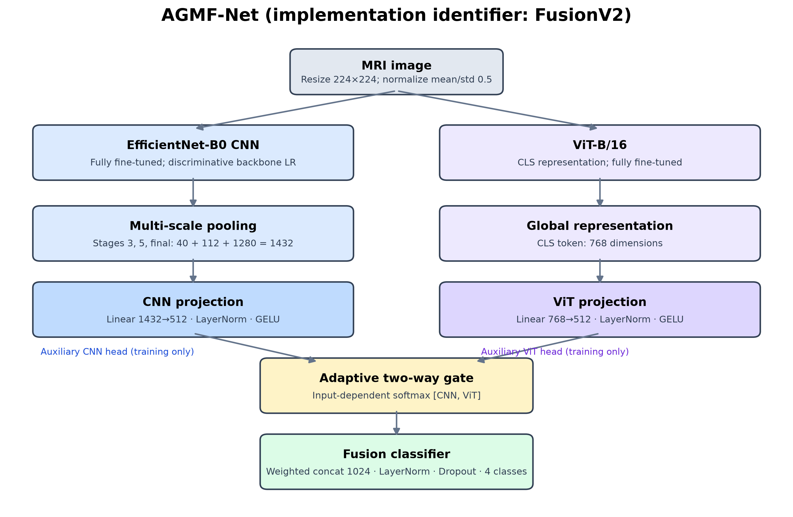
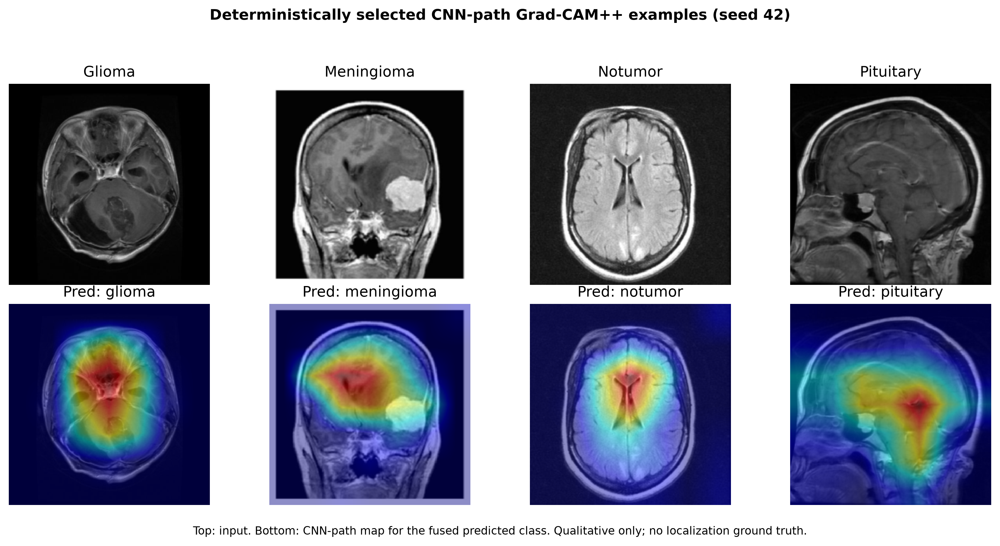
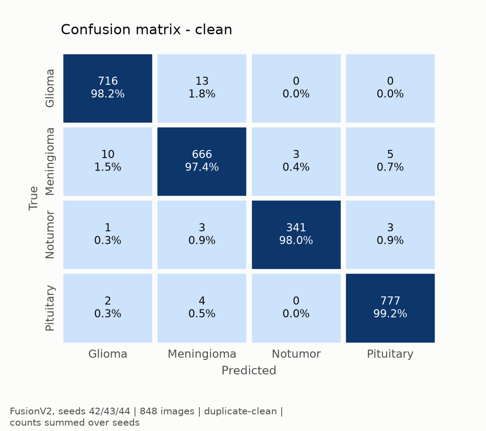
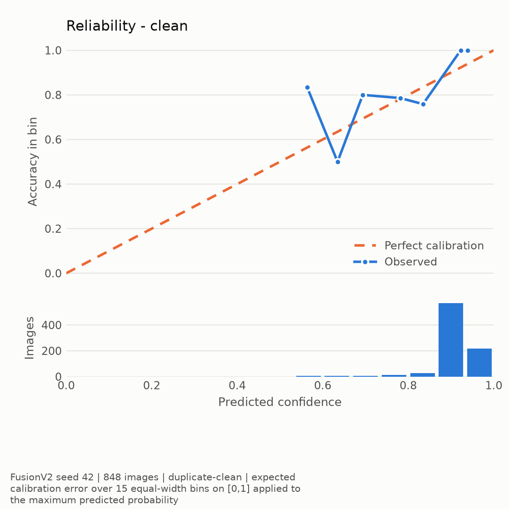
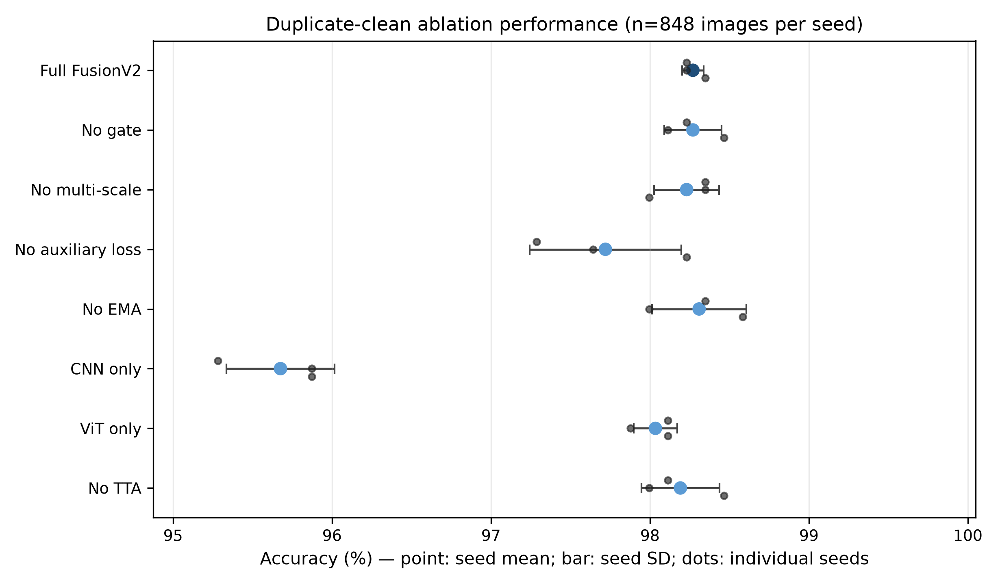
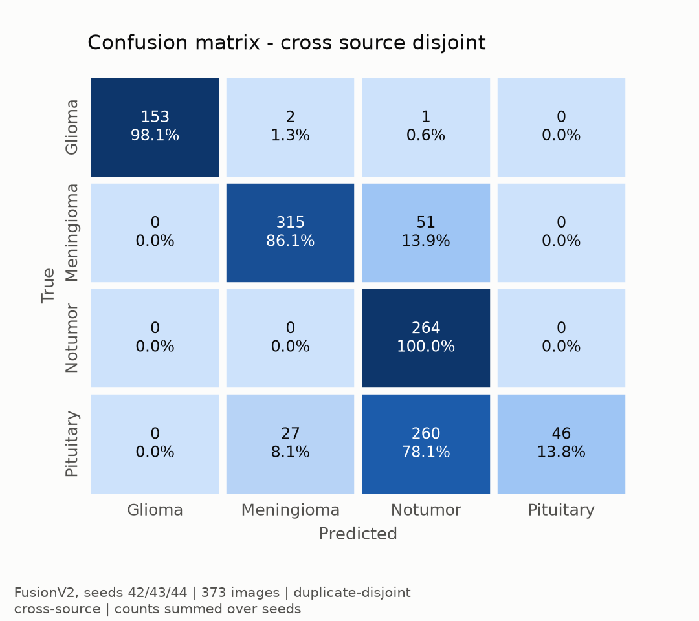

# B.TECH. PROJECT REPORT

## AGMF-Net: Adaptive Gated Multi-scale CNN–Vision Transformer Network for Brain MRI Classification

**Submitted by:** [STUDENT NAME(S) AND ENROLMENT NUMBER(S)]

**Under the supervision of:** [SUPERVISOR NAME AND DESIGNATION]

**Department:** [DEPARTMENT NAME]

**Institution:** [INSTITUTION NAME]

**Academic session:** [SESSION]

## Contents

1. Introduction  
2. Literature Review  
3. Problem Statement  
4. Methodology  
5. References

# 1. Introduction

Brain tumours are not a single, uniform condition. Their appearance changes with tumour type, location, size, imaging plane and acquisition conditions. Magnetic resonance imaging (MRI) is widely used to examine soft tissue in the brain because it provides strong structural contrast without ionising radiation. Even so, interpreting a scan remains a demanding task. A radiologist does not judge one isolated pattern; the decision is made using the complete study, the patient’s history and clinical experience. Computer-based image classification should therefore be viewed as a supporting research problem rather than a replacement for clinical assessment.

Deep learning has changed the way medical images are analysed. Earlier computer-vision pipelines depended on manually selected texture, shape and intensity measurements. Modern neural networks learn these representations directly from examples. Convolutional neural networks (CNNs) have been particularly successful because their filters respond to local edges, textures and spatial patterns. EfficientNet introduced a systematic way to scale network depth, width and resolution while retaining computational efficiency [1]. These properties make CNNs suitable for identifying local structures in MRI images, but repeated convolution and pooling can weaken long-range relationships.

Vision Transformers (ViTs) approach the image differently. An image is divided into patches, converted into a sequence and processed using self-attention [2]. This allows the model to relate distant regions directly. A ViT can therefore represent broad anatomical context, while a CNN retains a useful local inductive bias. Work such as Conformer has shown why convolutional and transformer representations can be complementary, although different hybrid models combine them in different ways [3].

The project began from this local–global motivation. The earlier implementation used an EfficientNet-B0 branch and a ViT-B/16 branch, pooled one final representation from each, concatenated them and passed the result through a fusion head. That design worked as a useful starting point, but it did not ensure that the two branches were contributing in a balanced way. The CNN was mostly frozen, only its final pooled vector was used, and plain concatenation allowed the classifier to rely mainly on the stronger branch.

The present model was developed to study these limitations. Its publication-facing name is **AGMF-Net**, meaning **Adaptive Gated Multi-scale Fusion Network**. The verified repository implementation is named `FusionV2`. AGMF-Net retains EfficientNet-B0 and ViT-B/16, but changes how their information is trained and combined. It draws CNN features from three depths, projects both branches to an equal 512-dimensional space, and uses a learned two-way gate whose output changes with the input image. Auxiliary branch classifiers are used during training so that both representations remain individually discriminative. Exponential moving-average weights and horizontal-flip test-time augmentation are also included in the complete configuration.

**Figure 1.** AGMF-Net architecture. The diagram shows the multi-depth CNN pathway, the ViT class-token pathway, equal-width projections, the input-dependent gate and the final four-class head.

The project deals with four image classes: glioma, meningioma, no-tumour and pituitary. The underlying aggregate dataset contains 7,023 JPEG images [4]. A central concern was that a random image split can give an overly optimistic result when visually similar images occur in both training and testing partitions. The work therefore includes two internal evaluations. The conventional split produced 99.14 ± 0.10% accuracy across three training seeds. A duplicate-aware split, treated as the primary internal evaluation, produced 98.27 ± 0.07%. A separate duplicate-disjoint cross-source subset produced 69.53 ± 1.98%, showing that high internal accuracy does not guarantee stable performance on images from another source.

This distinction shapes the purpose of the project. The aim is not merely to present the highest number. It is to build and examine a reproducible hybrid classifier, determine which parts contribute under controlled testing, report calibration and class-wise behaviour, and document the conditions under which performance declines. Patient identifiers are not available in the local dataset, so the evaluation is image-level and cannot be described as patient-independent.

# 2. Literature Review

## 2.1 CNN-based image representation

CNNs learn spatial features through shared filters. Early layers usually respond to simple edges and intensity transitions, while deeper layers encode more complex patterns. EfficientNet-B0 was selected for the convolutional branch because it provides a compact pretrained backbone and uses compound scaling to balance depth, width and resolution [1]. In AGMF-Net, the network is not restricted to the final 1,280-channel output. Features from intermediate stages with 40 and 112 channels are also pooled. These three levels are concatenated into a 1,432-dimensional vector. This is a project-specific multi-scale design; it should not be confused with a feature pyramid network.

Transfer learning allows representations learned from a large natural-image dataset to be adapted to a smaller target task. Yosinski et al. showed that the transferability of learned features depends on their depth and the relationship between source and target tasks [5]. This supports careful fine-tuning, but it does not prove that ImageNet features are automatically optimal for MRI. In the current model, the complete CNN and ViT backbones are trainable with a lower backbone learning rate than newly initialised fusion layers.

## 2.2 Vision Transformers and hybrid models

Dosovitskiy et al. introduced the ViT formulation in which fixed-size image patches are treated as tokens and processed by a transformer encoder [2]. The class-token representation provides a global summary used for classification. ViTs can model long-range dependencies directly, although they usually rely on substantial pretraining and do not contain the same locality bias as a CNN.

Hybrid architectures attempt to preserve both properties. Conformer couples convolutional local features and transformer global representations [3]. AGMF-Net shares the general local–global motivation but does not reproduce Conformer’s coupled blocks. Instead, its branches operate in parallel and meet at a learned fusion stage. Separate projections avoid comparing raw vectors of unequal widths, and a two-output softmax gate controls the relative branch mass for each image.

The two projected branches also receive auxiliary classification objectives. Deeply-Supervised Nets introduced the general principle of attaching companion objectives to intermediate representations [6]. In this project, auxiliary heads are used only during training. Their purpose is to discourage either branch from becoming an inactive passenger. The controlled no-auxiliary-loss experiment showed a mean reduction of 0.55 percentage points, but the seed-specific tests did not remain significant after multiple-comparison correction. The observed direction is therefore reported as suggestive rather than conclusive.

## 2.3 Training and regularisation

AGMF-Net uses AdamW, which decouples weight decay from the adaptive gradient update [7]. Label smoothing of 0.1 follows the regularisation principle described by Szegedy et al. [8]. The learning rate follows a cosine-annealing schedule; the implementation uses one non-restarting cycle even though SGDR is the relevant cosine-schedule precedent [9]. The complete model also evaluates exponential moving-average weights, a mechanism related to temporal weight averaging [10], and averages original and horizontally flipped predictions at inference as a simple test-time augmentation strategy [11].

The project does not assume that these additions are beneficial simply because they are established techniques. Each was examined against the complete model. Removing EMA or test-time augmentation did not produce a detectable accuracy loss under the current protocol. This negative result is important because it separates an implemented component from an empirically demonstrated contribution.

## 2.4 Brain MRI classification and the reference method

BRAIN-META is the principal reference paper for this project [12]. It combines ten CNN–ViT base learners and uses logistic regression and XGBoost to stack their probability outputs. The paper reports 97.10% accuracy and 96.94% F1 for the XGBoost meta-learner. It also applies CLAHE preprocessing and Grad-CAM visualisation. AGMF-Net takes a different route: one EfficientNet–ViT model performs feature-level fusion through a learned gate. The reported numbers cannot be treated as a controlled competition because the models use different preprocessing, partitions and prediction pipelines, and BRAIN-META per-image outputs are unavailable.

The aggregate four-class MRI benchmark is associated with a public dataset record [4]. A traceable component of the benchmark originates from the contrast-enhanced T1-weighted collection described by Cheng et al. [13]. However, patient identifiers and masks from that source are not present in the local JPEG export. It would therefore be incorrect to infer patient independence from the original dataset publication.

## 2.5 Evaluation reliability, calibration and explainability

Medical-imaging studies can overestimate performance when related images appear on both sides of a split. Tampu et al. demonstrated this risk in another imaging task [14], while Poldrack et al. provide broader guidance on cross-validation and group-aware evaluation in medical imaging [15]. These studies support a conservative evaluation approach, but they do not prove patient overlap in the present dataset. The accurate statement is that patient-level independence cannot be verified.

Generalisation can also deteriorate when acquisition sources change. Zech et al. showed that a model with strong internal performance could vary substantially across hospitals [16]. AGMF-Net’s cross-source result reflects a similar evaluation concern: it is evidence of degradation on one additional image source, not multicentre clinical validation.

Accuracy alone does not show whether model probabilities are reliable. Guo et al. discuss calibration errors in modern neural networks [17]. The project therefore records negative log-likelihood, multiclass Brier score, expected calibration error and reliability plots. The duplicate-clean mean expected calibration error is 0.0752, while the cross-source value increases to 0.1618.

Grad-CAM introduced gradient-based class activation maps for convolutional networks [18], and Grad-CAM++ refined the weighting of positive partial derivatives [19]. AGMF-Net uses Grad-CAM++ at the final spatial EfficientNet stage for the selected fused class. The map explains the CNN pathway for the original image view. It does not spatially explain the ViT branch, validate tumour boundaries or decompose the final TTA average.

**Figure 2.** First filename-ordered clean-test image from each class and its CNN-path Grad-CAM++ overlay. The examples are qualitative because no tumour masks or clinician localisation annotations were available.

# 3. Problem Statement

The project addresses the following problem:

> To design and evaluate a reproducible four-class brain MRI image classifier that combines local CNN information and global transformer information without relying on plain unequal-width concatenation, and to assess the model under duplicate-aware, component-wise and cross-source evaluation.

The earlier hybrid model exposed four practical gaps. First, the CNN branch was mostly frozen even though an independently fine-tuned CNN performed strongly. Second, only the final pooled CNN feature was used, so intermediate texture information was discarded. Third, raw 1,280-dimensional CNN and 768-dimensional ViT representations were concatenated directly. Fourth, neither branch had its own training objective, allowing one pathway to dominate without an explicit diagnostic signal.

The project also addresses an evaluation gap. A very high result on an image-wise split is not sufficient when the benchmark may contain visually redundant exports and lacks patient identifiers. A useful report must therefore distinguish the conventional split, the duplicate-clean split and the cross-source test. It must also avoid treating three predictions of the same image from different seeds as three independent cases.

The specific objectives are:

1. to implement multi-depth EfficientNet-B0 and ViT-B/16 feature extraction;
2. to project both branches into a common feature space and apply an input-dependent gate;
3. to supervise both branches during training and preserve an auditable final prediction path;
4. to evaluate seeds 42, 43 and 44 using class-wise, discrimination and calibration metrics;
5. to compare model components using paired predictions and corrected statistical tests;
6. to test duplicate-disjoint images from another source without tuning on their labels; and
7. to provide a local demonstration interface with probabilities, gate mass and CNN-path Grad-CAM++.

# 4. Methodology

## 4.1 Data preparation and duplicate-aware splitting

The source pool contains 7,023 labelled images. The duplicate-clean procedure grouped visually similar images using the recorded perceptual-hash rule and Hamming-distance threshold of eight. The audit identified 5,648 clusters and removed 1,375 redundant members. A seeded class-stratified partition produced 4,800 training images and 848 testing images. The clean test set contains 243 glioma, 228 meningioma, 116 no-tumour and 261 pituitary images.

This step operates at image level. It removes close visual redundancy according to the chosen rule but cannot identify images belonging to the same patient. Filename counters, directory structure and perceptual clusters were not used as substitute patient identifiers.

## 4.2 Input processing

Each image is converted to RGB and resized to 224 × 224 pixels. Tensor channels are normalised with mean 0.5 and standard deviation 0.5. Training augmentation uses a random resized crop with scale 0.8–1.0, horizontal flipping, rotation up to 15 degrees, and brightness and contrast jitter of 0.2. Evaluation uses deterministic resizing and normalisation.

## 4.3 Feature extraction and fusion

The EfficientNet branch supplies pooled stage-3, stage-5 and final-stage features. Concatenation gives a 1,432-dimensional CNN representation. A Linear–LayerNorm–GELU projection maps this vector to 512 dimensions. ViT-B/16 supplies a 768-dimensional class token, which is projected independently to 512 dimensions using the same operation pattern.

The gate receives the concatenated projected features. Two linear layers with GELU produce two logits, followed by softmax. The resulting CNN and ViT gate masses sum to one and vary with the input. Each projected vector is multiplied by twice its gate mass; the weighted vectors are concatenated into 1,024 dimensions. Layer normalisation, dropout and a linear classifier produce four logits. Separate auxiliary classifiers operate on the two branch projections during training.

## 4.4 Training protocol

Training uses batch size 16, AdamW, learning rate 0.0001, weight decay 0.05, label smoothing 0.1 and a cosine-annealing schedule. Pretrained backbone parameters use one tenth of the learning rate used for newly initialised modules. The maximum duration is 15 epochs, with early stopping after four validation epochs without improvement. The auxiliary-loss weight is 0.3. The full protocol enables EMA and horizontal-flip TTA. The best validation model is evaluated; final test labels are not used for model selection.

## 4.5 Evaluation measures

The stored prediction files are used to compute accuracy, balanced accuracy, macro precision, macro recall, macro-F1, per-class sensitivity and specificity, one-versus-rest ROC-AUC, average precision, negative log-likelihood, multiclass Brier score and 15-bin expected calibration error. Image-level 95% bootstrap intervals use 2,000 class-stratified resamples with fixed seed 12,345. Variation across the three training seeds is reported separately as sample standard deviation.

**Figure 3.** Duplicate-clean confusion matrices for seeds 42–44. Rows show true classes and columns show predicted classes.

**Figure 4.** Duplicate-clean reliability curves and confidence-bin counts. The low-confidence region contains relatively few images.

## 4.6 Controlled ablations

Seven controls were evaluated against the full model: no gate, no multi-scale taps, no auxiliary loss, no EMA, CNN branch only, ViT branch only and no TTA. Training variants use identical partitions and seeds. No-TTA is evaluation-only and reuses the verified full checkpoints. Exact filename and label alignment is checked before paired comparisons. McNemar tests are performed separately for every seed, followed by Holm correction across all 21 comparisons [20].

**Figure 5.** Duplicate-clean accuracy for the complete model and controlled ablations. Removing the ViT branch produced the clearest loss.

The full model obtains 98.27 ± 0.07% duplicate-clean accuracy. CNN-only accuracy is 95.68 ± 0.34%, a decrease of 2.59 percentage points, significant for all three seeds after correction. ViT-only accuracy is 98.03 ± 0.14%, a smaller and statistically inconclusive difference. The learned gate, multi-scale taps, EMA and TTA do not show detectable accuracy benefits under this protocol. These findings prevent architectural descriptions from being presented automatically as proven improvements.

## 4.7 Cross-source evaluation

The duplicate-disjoint cross-source subset contains 373 images and is used only for evaluation. AGMF-Net obtains 69.53 ± 1.98% accuracy and 68.69 ± 2.21% macro-F1. The failure is concentrated in pituitary images: across the three seeds, 260 of 333 repeated predictions for the same 111 pituitary images are no-tumour. These are repeated outputs, not 333 independent subjects.

**Figure 6.** Cross-source confusion matrices. The pattern shows substantial pituitary-to-no-tumour confusion.

## 4.8 Demonstration interface

A local Streamlit application loads one of the three hash-verified checkpoints. It accepts common image files, applies the evaluation transform, and displays the predicted class, all four softmax values, top-two margin, normalised entropy and dynamic gate mass. Grad-CAM++ is generated on demand. The demonstration does not change model weights and is not part of model selection.

# 5. References

1. Tan M, Le QV. EfficientNet: Rethinking Model Scaling for Convolutional Neural Networks. Proceedings of ICML. 2019;97:6105–6114. https://proceedings.mlr.press/v97/tan19a.html
2. Dosovitskiy A, et al. An Image Is Worth 16×16 Words: Transformers for Image Recognition at Scale. ICLR. 2021. https://openreview.net/forum?id=YicbFdNTTy
3. Peng Z, et al. Conformer: Local Features Coupling Global Representations for Visual Recognition. ICCV. 2021:367–376. https://doi.org/10.1109/ICCV48922.2021.00042
4. Nickparvar M. Brain Tumor MRI Dataset. Kaggle. 2021. https://www.kaggle.com/dsv/2645886
5. Yosinski J, Clune J, Bengio Y, Lipson H. How Transferable Are Features in Deep Neural Networks? NeurIPS. 2014;27. https://proceedings.neurips.cc/paper/2014/hash/532a2f85b6977104bc93f8580abbb330-Abstract.html
6. Lee CY, Xie S, Gallagher P, Zhang Z, Tu Z. Deeply-Supervised Nets. AISTATS. 2015;38:562–570. https://proceedings.mlr.press/v38/lee15a.html
7. Loshchilov I, Hutter F. Decoupled Weight Decay Regularization. ICLR. 2019. https://openreview.net/forum?id=Bkg6RiCqY7
8. Szegedy C, et al. Rethinking the Inception Architecture for Computer Vision. CVPR. 2016:2818–2826. https://doi.org/10.1109/CVPR.2016.308
9. Loshchilov I, Hutter F. SGDR: Stochastic Gradient Descent with Warm Restarts. ICLR. 2017. https://openreview.net/forum?id=Skq89Scxx
10. Tarvainen A, Valpola H. Mean Teachers Are Better Role Models. NeurIPS. 2017;30. https://proceedings.neurips.cc/paper/2017/hash/68053af2923e00204c3ca7c6a3150cf7-Abstract.html
11. Shanmugam D, Blalock D, Balakrishnan G, Guttag J. Better Aggregation in Test-Time Augmentation. 2020. https://arxiv.org/abs/2011.11156
12. Napa KK, Murugan S, Murugan JS, Jayanthi A. BRAIN-META: A Reproducible CNN–Vision Transformer Meta-Ensemble Pipeline for Explainable Brain Tumor Classification. MethodsX. 2026;16:103769. https://doi.org/10.1016/j.mex.2025.103769
13. Cheng J, et al. Enhanced Performance of Brain Tumor Classification via Tumor Region Augmentation and Partition. PLOS ONE. 2015;10:e0140381. https://doi.org/10.1371/journal.pone.0140381
14. Tampu IE, et al. Inflation of Test Accuracy Due to Data Leakage in Deep Learning-Based Classification of OCT Images. Scientific Data. 2022;9:580. https://doi.org/10.1038/s41597-022-01618-6
15. Poldrack RA, et al. A Guide to Cross-Validation for Artificial Intelligence in Medical Imaging. Radiology: Artificial Intelligence. 2023. https://doi.org/10.1148/ryai.220232
16. Zech JR, et al. Variable Generalization Performance of a Deep Learning Model to Detect Pneumonia in Chest Radiographs. PLOS Medicine. 2018;15:e1002683. https://doi.org/10.1371/journal.pmed.1002683
17. Guo C, Pleiss G, Sun Y, Weinberger KQ. On Calibration of Modern Neural Networks. ICML. 2017;70:1321–1330. https://proceedings.mlr.press/v70/guo17a.html
18. Selvaraju RR, et al. Grad-CAM: Visual Explanations from Deep Networks via Gradient-Based Localization. ICCV. 2017:618–626. https://doi.org/10.1109/ICCV.2017.74
19. Chattopadhay A, Sarkar A, Howlader P, Balasubramanian VN. Grad-CAM++: Generalized Gradient-Based Visual Explanations for Deep Convolutional Networks. WACV. 2018:839–847. https://doi.org/10.1109/WACV.2018.00097
20. McNemar Q. Note on the Sampling Error of the Difference Between Correlated Proportions or Percentages. Psychometrika. 1947;12:153–157. https://doi.org/10.1007/BF02295996
